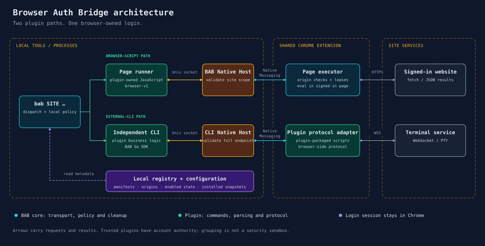

# Architecture

English | [简体中文](architecture.zh-CN.md) · [Home](../README.md)

BAB connects local tools to browser-owned login. The core manages transport,
registered origins and session cleanup; plugins own site behavior.

## Components

| Component | Responsibility | Source |
| --- | --- | --- |
| BAB CLI | Discover installed plugins, apply enabled state, run page commands or dispatch a CLI | [`cmd/bab`](../cmd/bab) |
| Plugin package | Commands, parsing, site protocol, manifests and optional browser adapters | [`plugins`](../plugins/README.md) |
| Go SDK and Native Host | Scoped messages, local Unix sockets and Chrome Native Messaging | [`bridge`](../bridge), [`nativehost`](../nativehost) |
| Shared Chrome extension | Host grants, origin checks, page leases and stream routing | [`internal/extension`](../internal/extension) |
| User configuration | Installed snapshots, chosen origins and enabled state | Local `~/.bab/`, outside tracked source |

## Two common execution paths

**Page commands.** `bab SITE COMMAND` loads a plugin-owned script and arguments.
The BAB Native Host validates the registered site. The extension checks the host
grant and exact origin, then evaluates the script in a page lease. Requests use
the page's login; JSON results or explicitly requested artifacts return to the CLI.
The core does not parse the site's responses.

**Independent CLI.** BAB dispatches the executable declared by the plugin.
That CLI uses the Go SDK and supplies its Native Host validation and protocol
adapter. Local sockets and Native Messaging connect it to the shared extension;
the adapter performs browser-side requests or terminal handshakes. For example,
the ttyd adapter opens the authenticated WebSocket inside Chrome.

These are integration examples, not a protocol restriction: an external CLI can
also use `browser-v1`. A consumer can run directly once its SDK integration and
host setup are complete. BAB registers declared hosts; its generated consumer
launcher retains configured origins and enabled-state checks where applicable.

## Contracts and ownership

- `browser-v1`: `open` / `eval` / `close`, page leases and JSON results.
- `pty-v1`: full-duplex terminal sessions using a validated recipe or packaged adapter.
- Native Hosts validate the consumer's site, operation and complete endpoint or recipe.
- Plugin scripts and adapters contain site-specific endpoints, selectors and parsing.
  The core does not import consumer implementations.

`commandstream` and `pool` are optional consumer-side helpers, not required
dependencies for every plugin. Deployment and account provisioning belong to
the operator. See the [plugin contract](plugin-development.md) and
[ttyd implementation notes](../plugins/builtin/ttyd/DEVELOPMENT.md).

## Configuration and trust

Installation copies selected plugin snapshots into the user's registry; it does
not grant a host permission or sign into a website. Declared browser components
are assembled from installed snapshots and require reloading the same extension
after changes. Ordinary page-command script changes need no extension reload.

Plugin state, Chrome authorization and website login are separate. The native
registry confirms which managed providers may run; disabling a plugin blocks its
BAB commands and stops managed sessions while retaining its host grant.

Plugins and same-user local callers are trusted. Origin checks are routing policy,
not a sandbox for hostile code; plugin output can contain account secrets.
Ambiguous commands are not automatically replayed, and sessions are not durable
across browser restarts. See [Security](../SECURITY.md).

The diagram is editable SVG with no external fonts or scripts.
