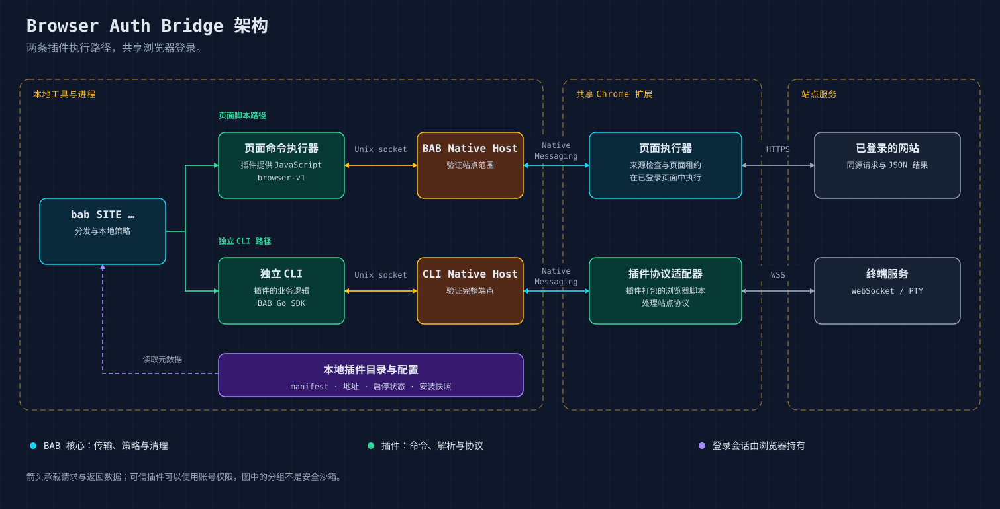

# 项目架构

[English](architecture.md) | 简体中文 · [首页](../README.zh-CN.md)

BAB 将本地工具连接到浏览器中的登录会话。
核心负责传输、已注册来源和会话清理；插件负责站点业务。

## 组件职责

| 组件 | 职责 | 源码 |
| --- | --- | --- |
| BAB CLI | 发现已安装插件、检查启停状态、执行页面命令或分发外部 CLI | [`cmd/bab`](../cmd/bab) |
| 插件包 | 命令、解析、站点协议、manifest 和可选浏览器适配器 | [插件目录](../plugins/README.zh-CN.md) |
| Go SDK 与 Native Host | 范围约束、Unix socket 和 Chrome Native Messaging | [`bridge`](../bridge)、[`nativehost`](../nativehost) |
| 共享 Chrome 扩展 | 站点授权、来源检查、页面租约和流路由 | [`internal/extension`](../internal/extension) |
| 用户配置 | 安装快照、选定地址和启停状态 | 本机 `~/.bab/`，不进入 Git |

## 两条常见执行路径

**页面命令。** `bab SITE COMMAND` 读取插件提供的脚本和参数。
BAB Native Host 验证注册站点；扩展检查主机授权和精确来源，再通过页面租约
执行脚本。请求使用页面登录，JSON 结果或明确请求的文件返回 CLI。
站点响应由插件解析，核心不包含站点业务逻辑。

**独立 CLI。** BAB 调用插件声明的可执行程序。该程序使用 Go SDK，
提供自己的 Native Host 校验和协议适配器，经本地 socket、Native Messaging
连接共享扩展；适配器在浏览器中完成请求或终端握手。
例如 ttyd 适配器在 Chrome 内打开已认证的 WebSocket。

这两条路径是接入示例，不是协议限制：独立 CLI 也可以使用 `browser-v1`。
完成 SDK 接入和 Host 配置后，消费方可以直接运行。
BAB 负责注册声明的 Host；适用时，生成的消费方启动器会保留选定来源和启停检查。

## 契约与归属

- `browser-v1`：`open` / `eval` / `close`、页面租约和 JSON 结果。
- `pty-v1`：通过已验证的配方或打包适配器承载双向终端会话。
- Native Host 校验消费方的站点、操作及完整端点或配方。
- 站点端点、DOM 选择器和解析逻辑放在插件中，核心不导入消费方实现。

`commandstream`、`pool` 是消费方可选的辅助包，并非所有插件的必需依赖。
服务部署和账号配置由运维方负责。详见[插件契约（英文）](plugin-development.md)
和 [ttyd 实现说明（英文）](../plugins/builtin/ttyd/DEVELOPMENT.md)。

## 配置与信任边界

安装只将选定插件复制到用户目录，不授予站点权限，也不登录网站。
声明的浏览器组件从安装快照组装，变化后需要重新加载原扩展；
普通页面命令脚本变化无需重载扩展。

插件启停、Chrome 授权和站点登录相互独立。扩展根据 Native Host 确认的插件目录
启用托管组件；停用会阻止 BAB 命令并停止托管会话，保留站点授权。

插件及同一用户的本地进程属于可信调用方。来源检查是路由策略，不能隔离恶意代码；
插件输出也可能包含账号秘密。结果不明确的命令不会自动重放，会话不跨浏览器重启恢复。
详见[安全说明（英文）](../SECURITY.md)。

架构图为可编辑 SVG，不依赖外部字体或脚本。
